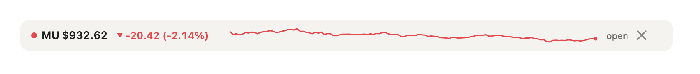

# stock-ticker

A [Claude Code mod](https://claude.dev/blog/getting-started-with-claude-code-mods/) that keeps one stock above your prompt: a slim row with the live price, the day's change, and a line of the last two hours.



## Install

In a terminal session of Claude Code:

```
/plugin install stock-ticker --marketplace migmorales22/claude-stock-ticker
```

Answer `y` to add the marketplace, then pick a scope (user scope loads it in every session, the desktop app's Code tab included). Needs a Claude Code version with mods enabled. The live price needs [Node.js](https://nodejs.org) 22 or newer on the machine; without it the row still works, updating every 15 seconds.

## Use

| Command | What it does |
|---|---|
| `/stock AAPL` | Watch a stock. Any Yahoo Finance symbol: `TSLA`, `BRK-B`, `^GSPC`, `BTC-USD`, `EURUSD=X`. |
| `/stock` | Print the current quote in the chat. |
| `/stock off` | Stop watching and hide the row (the ✕ on the row does the same). |
| `/stock debug` | What the row last drew and whether the live stream is on. |

The symbol is remembered, so the row comes back in your next session.

## How it works

- **The price is live.** While the market trades, the mod runs `stream/yahoo-stream.mjs`, a small Node script that holds Yahoo Finance's price stream open and passes each new price on, about one a second for a busy stock. Each one moves the price and the end of the line. The script stops when the market closes, on `/stock off`, and with the session.
- **The line** is the last 120 one-minute closes plus the live price: each new minute scrolls it left, and it scales to its own high and low so small moves show. Yesterday's close is dashed when the line reaches it. The color follows the day: green up, red down.
- **If the stream is down** (no Node, or Yahoo changes it), the row reads the price from Yahoo's chart endpoint every 15 seconds instead, and says `offline` if that fails too. While the market is closed it checks every 10 minutes.
- **No tokens.** It never calls Claude. The only thing that enters the conversation is the one-line reply to a `/stock` command you type.
- The desktop app draws the row as a picture; a terminal shows one line with a block-character sparkline.

## Data and privacy

Prices come from Yahoo Finance's public chart endpoint and price stream. Both are unofficial and undocumented: no account or key, but they can change or stop without notice. US stocks are real time; some other exchanges are delayed. The only thing sent is the ticker symbol.

For information only, not financial advice.

## Develop

```bash
claude plugin validate .
claude plugin test .     # 6 tests, network and stream mocked
```

A note for anyone drawing SVG in a mod: the desktop app drew nothing at all, and logged nothing, for an early version whose SVG held a `▼` character, inline `style=` attributes and a `<polyline>`. Keeping the SVG plain ASCII (anything else as `&#N;`) and drawing glyphs as paths fixed it.

## License

MIT
